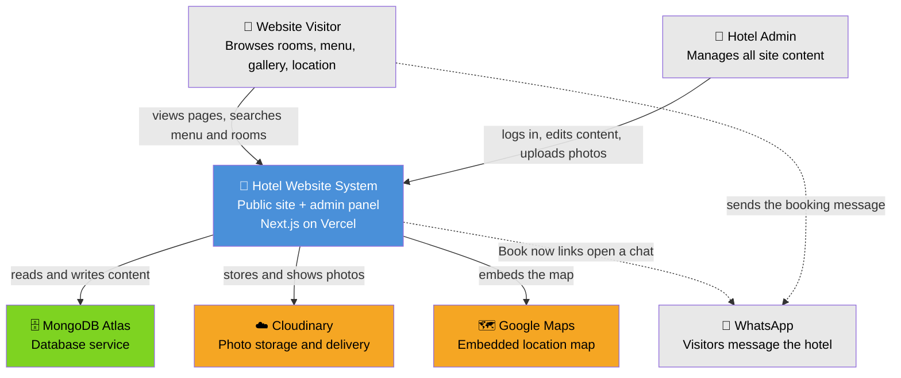

# System Context Diagram (C4 Level 1)

The highest-level view of the Hotel Website: who uses it and which outside
services it depends on. No internal detail yet. See `02-container.md` for the
next zoom level.

## Reading this diagram

- Solid arrows are real integrations. Dotted arrows are links only: the site
  never talks to WhatsApp itself, it gives the visitor a pre-filled chat link.
- Online booking, food ordering, payments, and reports (future phases) will add
  new outside systems here, for example a payment gateway, without changing the
  rest of the diagram.
