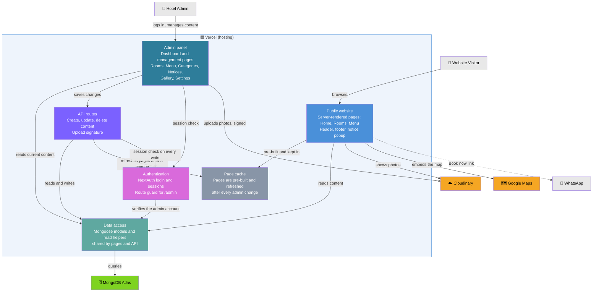

# Container Diagram (C4 Level 2)

Opens up the "Hotel Website System" box from `01-context.md` and shows the
major pieces running inside it. The next zoom level is split in two:
`03-component.md` (admin panel and API) and `04-component-public.md` (public
website).

## Reading this diagram

- **Pages read data directly, writes go through the API.** Public and admin
  pages are rendered on the server and read content through the shared data
  access layer. Only changes (create, update, delete, reorder, upload
  signature) travel through API routes. This replaces the Phase 2 rule that
  "everything goes through the API"; the reasoning is in ADR 0011.
- **Browser code never touches the database or the secrets.** Client
  components only call API routes. Uploads go from the admin's browser straight
  to Cloudinary, using a signature the API issues after checking the session.
- **The cache is why edits show up instantly.** Public pages are pre-built for
  speed. Every successful admin change triggers a refresh, and pages also
  refresh at least hourly as a safety net.
- **Because pages skip the API for reads, they must protect themselves.** Admin
  pages are guarded by the route guard and by a second session check in the
  panel layout.

## For future upgrades

Booking, ordering, and payments will add new API routes, new collections in the
data layer, and one or two new outside systems at this level. Nothing drawn
here needs restructuring.
