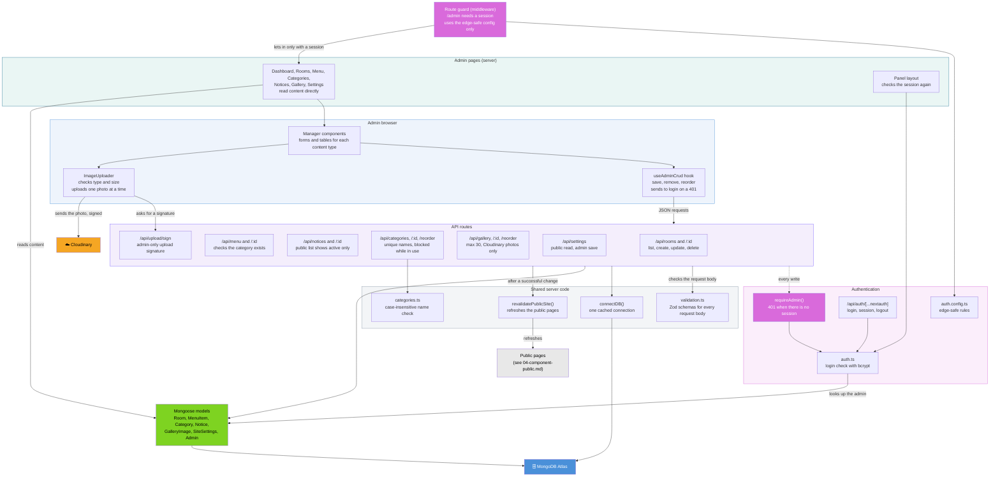

# Component Diagram: Admin Panel and API (C4 Level 3)

Zooms into the admin panel, API routes, and authentication containers from
`02-container.md`. The public website has its own diagram in
`04-component-public.md`.

## Rules for anyone writing code here

- **Every write handler starts with `requireAdmin()`.** Public `GET` handlers
  are the only routes without it. The upload signature route counts as a write.
- **Validate before touching the database.** Parse the body with the matching
  Zod schema and return `400` with field errors on failure. Updates use
  `.partial()`, and the schemas have no `.default()` on purpose (ADR 0006).
- **Refresh the public site after a change.** Call `revalidatePublicSite()`
  after the database change succeeds and just before returning success, never
  before validation or on a failed request.
- **New admin pages must live under `src/app/admin/(panel)/`.** Admin pages
  read data directly instead of through the API, so they rely on the route
  guard and the panel layout's session check for protection. A page placed
  outside `(panel)` would skip both.
- **Business rules live in the API.** Categories cannot be deleted while menu
  items use them, category names are unique ignoring capital letters, the
  gallery holds at most 30 photos and only accepts Cloudinary addresses.
- **Auth config is split on purpose.** `auth.config.ts` runs at the edge and
  must stay free of bcrypt and database code (ADR 0007).
