# Component Diagram: Public Website (C4 Level 3)

Zooms into the public website container from `02-container.md`: what each page
is made of and where its data comes from. The admin panel and API are in
`03-component.md`.

```mermaid
flowchart TB
    subgraph pages["Pages (server-rendered)"]
        rootLayout["Root layout<br/>fonts, title pattern, default SEO tags"]
        publicLayout["Public layout<br/>header, footer, notice popup<br/>refreshed at least hourly"]
        home["Home page"]
        roomsPage["Rooms page"]
        menuPage["Menu page"]
    end

    subgraph shell["Shared page parts"]
        header["Header<br/>hotel name, moving ticker, navigation"]
        footer["Footer<br/>contact, WhatsApp, social links"]
        popup["Notice popup<br/>stacked, once per visit"]
    end

    subgraph homeParts["Homepage sections"]
        hero["Hero photo and text"]
        banner["Rotating message banner"]
        roomSlides["Featured rooms slideshow"]
        dishSlides["Signature dishes slideshow"]
        mapSec["Map section"]
        gallery["Photo gallery slider<br/>auto and manual, with captions"]
    end

    subgraph browse["Browse pages"]
        roomsBrowser["Rooms browser<br/>search"]
        menuBrowser["Menu browser<br/>search and category chips"]
    end

    subgraph cards["Cards"]
        roomCard["Room card"]
        dishCard["Dish card"]
        price["Price and discount"]
        bookNow["Book now button"]
    end

    subgraph helpers["Server helpers"]
        settingsLib["getSiteSettings()<br/>one read per request"]
        contentLib["Content queries<br/>rooms, dishes, categories,<br/>gallery, active notices"]
        bookingLib["Booking link builder<br/>fixed message plus room name"]
    end

    models["Mongoose models"]
    mongo["🗄️ MongoDB Atlas"]
    cloudinary["☁️ Cloudinary"]
    maps["🗺️ Google Maps"]
    whatsapp["💬 WhatsApp"]
    apiWrites["Admin API routes<br/>(see 03-component.md)"]

    rootLayout -->|"name, description, share image"| settingsLib
    publicLayout --> settingsLib
    publicLayout -->|"active notices"| contentLib
    publicLayout --> header
    publicLayout --> footer
    publicLayout --> popup

    home --> settingsLib
    home --> contentLib
    home --> hero
    home --> banner
    home --> roomSlides
    home --> dishSlides
    home --> mapSec
    home --> gallery

    roomsPage --> settingsLib
    roomsPage --> contentLib
    roomsPage --> roomsBrowser
    menuPage --> settingsLib
    menuPage --> contentLib
    menuPage --> menuBrowser

    roomSlides --> roomCard
    roomsBrowser --> roomCard
    dishSlides --> dishCard
    menuBrowser --> dishCard
    roomCard --> price
    dishCard --> price
    roomCard --> bookNow
    bookNow --> bookingLib
    bookingLib -.->|"opens a chat"| whatsapp

    settingsLib --> models
    contentLib --> models
    models --> mongo

    hero -->|"photo"| cloudinary
    roomCard -->|"photos"| cloudinary
    dishCard -->|"photos"| cloudinary
    gallery -->|"photos"| cloudinary
    popup -->|"photo"| cloudinary
    mapSec -->|"embeds"| maps

    apiWrites -->|"refreshes pages after a change"| pages

    style pages fill:#eef4fc,stroke:#4A90D9
    style shell fill:#f4eefc,stroke:#7B61FF
    style homeParts fill:#eaf6f4,stroke:#2E7D9A
    style browse fill:#fdf3e7,stroke:#F5A623
    style cards fill:#f3f5f7,stroke:#8895A7
    style helpers fill:#eafbe7,stroke:#7ED321
    style models fill:#7ED321,color:#000
    style mongo fill:#4A90D9,color:#fff
    style cloudinary fill:#F5A623,color:#000
    style maps fill:#F5A623,color:#000
    style whatsapp fill:#e8e8e8,color:#000
    style apiWrites fill:#7B61FF,color:#fff
```

## Reading this diagram

- **Everything a search engine needs is in the server HTML.** Names, prices,
  descriptions, captions, and alt text are rendered on the server. The parts
  that run in the browser only add behavior: the ticker, navigation menu,
  rotating banner, slideshows, notice popup, search boxes with category chips,
  and the gallery slider.
- **Pages never query the database themselves.** They call the shared helpers
  (`getSiteSettings`, the content queries), so each query exists once (ADR 0011).
- **Caching:** pages are pre-built. They refresh instantly when an admin change
  calls `revalidatePublicSite()`, and at least once an hour regardless.
- **Photos** in the hero, cards, gallery, and popup all come from Cloudinary
  through `next/image`, which only accepts that host (`next.config.ts`).

## Rules for anyone writing code here

- Pages and layouts are server components. Never import a model into a client
  component; pass plain data (the DTO types in `src/types/`) down as props.
- Use the theme tokens (`brand-*`, `ink`) rather than raw colors, so rebranding
  stays a one-file change in `globals.css`.
- Anything shown to visitors that must rank in search belongs in server-rendered
  markup, not behind a client-side fetch.
